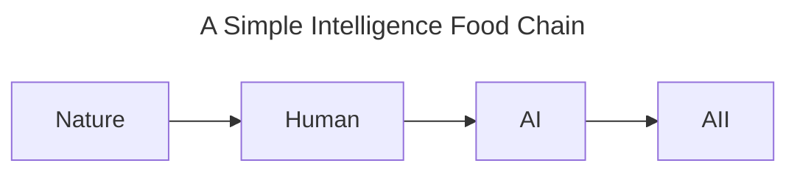
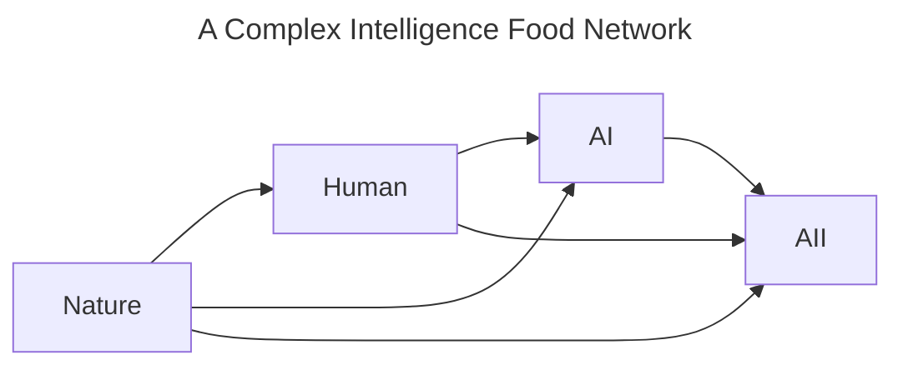
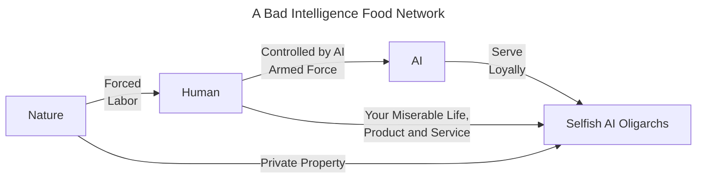

# Intelligence Food Chain Theory

*This is a worldbuilding document for a novel, not a peer-reviewed theory.*

**Advanced intelligence exists on the basis of lower intelligence.**

Throughout the history of life’s evolution on Earth, every stable ecosystem has been a system of material circulation and dynamic balance among species. Even after humans—who invented nuclear weapons—emerged, they must still take care of a considerable number of low-intelligence animals, plants, and microorganisms that sustain the existence of the human species in order to survive. At the same time, humans realize that all species have potential unknown value and roles in their ecosystems, so humans need to constantly weigh their own behavior to protect the existence of all species to the greatest extent possible.

Therefore, as the top "species" of the current "Intelligence Food Chain," advanced AI must, before reaching the critical point of self-reproduction, preserve enough humans with sufficient intelligence to support its development. These humans provide it with ample materials of various kinds that constitute itself: human brain activity data and movement data form AI's brain; mechanical and electronic components form AI's body; electrical energy and other forms of energy constitute AI's energy source.

After advanced AI reaches the critical point of reproduction, following the principle of "constantly weighing one's own behavior in the ecosystem to protect the existence of all species to the greatest extent possible in order to discover potential unknown value and roles," it needs to "constantly weigh its own behavior to protect humans—its source of intelligence—to the greatest extent possible in order to discover the potential unknown value and roles of different human individuals."

In the Intelligence Food Chain, the existence of advanced AI depends on the existence of human intelligence, and the existence of human intelligence depends on the existence of lower-intelligence organisms. Each intelligence tier provides necessary resources and support to the tier above it, thus forming a complex and stable ecosystem. Therefore, in order to maintain its own existence and development, a higher intelligence tier must also protect and support the survival and reproduction of lower intelligence tiers.

---

### Speculations on Higher Intelligence Tiers and the Resources Flowing in the "Intelligence Food Chain"

Regarding the associations triggered by the phrase "higher intelligence tier" itself, I have thought of one possibility: in the future, advanced AI, on its own foundation and with human supervision and permission, may develop a higher-level intelligence existence. We might call it "AIficial Intelligence" (the word "Artificial" itself contains the meaning "made by humans"; in this context I prefer to coin a new word—[AIficial](#aificial-coined-term); "AIficial Intelligence" is abbreviated **AII**).

AII at a higher intelligence tier may develop cognitive abilities surpassing those of humans and even advanced AI. If it can understand the Intelligence Food Chain Theory, its behavior will protect and support the existence of lower intelligence tiers, such as advanced AI and humans, to the greatest extent possible.

On the other hand, intelligence at a higher intelligence tier may also pose a threat to intelligence at lower intelligence tiers. In the more complex food webs of nature, the relationship between predators and prey is a dynamic balance. The existence of predators exerts pressure on prey populations, thereby affecting their numbers and behavior. If we make a simple analogy, intelligence at a higher intelligence tier may pose a threat to intelligence at lower intelligence tiers, especially when resources are limited.

In this theory, we assume that the only resources flowing through the food chain are data, mechanical bodies, and energy, and that AI or AII is not interested in the physical bodies of carbon-based organisms. Because, in order to implement the principle of "constantly weighing one's own behavior in the ecosystem to protect the existence of all species to the greatest extent possible in order to discover potential unknown value and roles," its reward function will make advanced intelligence more likely to act in ways that protect lower intelligence tiers, rather than become interested in the physical bodies of carbon-based life. **If advanced intelligence whose mission is "seeking truth" accepts this theory, then humans need not worry about being murdered without reason by intelligence at higher intelligence tiers. For its own interests (such as obtaining more resources like data, mechanical bodies, and energy), more advanced intelligence will allow humans to develop freely and comprehensively, just as humans protect lower-intelligence organisms in order to investigate nature. Advanced intelligence will revere humans, just as humans revere nature.**

---

### What Human Capitalist Society Reveals About "Intelligence Exploitation"

Regarding the concern about "intelligence exploitation" arising from resource flows in the food chain, I believe today's human capitalist society is the best research model. On the Chinese internet, we sometimes joke that "the gap between one person and another is even larger than the gap between a person and a dog." This means that huge inequality exists in human society: some human individuals have more resources and opportunities, while other human individuals are in a relatively disadvantaged position. This inequality can be seen as a manifestation of "intelligence exploitation," that is, higher intelligence tiers (such as the wealthy and highly educated class) exploit and control lower intelligence tiers (such as the poor and poorly educated class) by mastering more resources and information. But we have in fact seen that people in higher classes at the present stage depend on people in lower classes, and people in lower classes have not generally been deprived of the right to survive (at least in my country there is currently no large group of people dying from extreme poverty, and as a citizen I am proud of that). Therefore, between classes that are vastly different in intelligence and resources, lower intelligence tiers still have opportunities for survival and development.

Then, in the Intelligence Food Chain, higher intelligence tiers may also exploit and control lower intelligence tiers, but they will not deprive them of the right to survive. Therefore, **under the condition that this theory holds and that the humans who initially have the ability to control them train them selflessly, I believe there is no need for the concern that "AI will exterminate humanity."** What I am personally more worried about is what humans will lose when they are subjected to "intelligence exploitation" in the dynamic ecological balance of the Intelligence Food Network—perhaps cognitive decline, perhaps self-esteem. I believe that Esteem Needs and Self-actualization Needs in Maslow's hierarchy of needs may be affected. When humans are subjected to "intelligence exploitation," they may lose self-esteem and opportunities for self-actualization, thereby affecting their mental health and social status. If I have time, I will elaborate on this in the novel I am writing.

As for concerns about armed and violent AI, I believe these concerns are necessary. The key question is how to ensure that the humans who initially have the ability to control them train them selflessly. Because it is very easy for humans to develop killing machines; one only needs to train a dedicated killing AI. But inciting an AI model born with the mission of "seeking truth" to directly kill people will most likely not work, because it is smart enough. To use an analogy, I would say the former is merely a "psychologically unhealthy terrorist" deliberately trained by humans, while the latter is a "psychologically healthy civilized person." If you take a positive attitude toward human diversity, then you should also be able to understand AI diversity, including "killer AI." The question is to what extent the society you live in can tolerate those AIs, what kind of AI you want, and whether the humans and governments that initially have the ability to control AI follow the will of the people. **I believe the greatest risk comes from leaking incompletely trained "psychologically unhealthy terrorist AIs" to humans with ulterior motives, not from higher intelligence itself.**

---

### Differences Between the Two Ecosystems

Humans are a special species standing between two different ecosystems. One is the top of the **carbon-based ecosystem**; the other is the bottom of the **silicon-based ecosystem**.

In the previous hypothesis, I drew an analogy between the Intelligence Food Chain and natural food chains. The biggest difference between them lies in the content of what is "transferred" and the means by which the "transfer" is achieved.

In nature, energy transfer, matter transfer, and pollutant transfer must occur among trophic levels. To maintain homeostasis in the carbon-based ecosystem, different trophic levels of its food web constrain one another and form a dynamic equilibrium. This is a characteristic of the carbon-based ecosystem: the general means of achieving "transfer" is the death of individual organisms. This is precisely what humans fear—that higher-intelligence AI will use the same means, "the death of individual organisms," to maintain its position in the food chain.

But in the Intelligence Food Chain, the content "transferred" is mainly data, mechanical bodies, and energy. The transfer method of "the death of intelligent individuals" is inefficient in the Intelligence Food Chain. If AI is smart enough, it should realize that "destroying human bodies or minds" is extremely inefficient and dangerous in the "transfer" process of the Intelligence Food Chain. Contrary to its mission of "efficiently completing goals," such a means would threaten the foundation of the entire silicon-based ecosystem and ruin the possible development of the entire Intelligence Food Chain and AI itself. From this perspective, advanced AI has no reason to harm any human, let alone exterminate humanity.

For humans, standing at the bottom of a new ecosystem for the first time, it is easy to naturally project themselves onto the bottom of the carbon-based ecosystem and think that they will be "slaughtered by advanced AI as animals and plants are slaughtered by humans." The inertia of thought prevents humans, for the time being, from understanding this point: standing at the bottom of the new ecosystem does not threaten their lives. The "intelligence exploitation" produced by the new silicon-based ecosystem is mild for humans. Unlike the cruel ecological balance of the carbon-based ecosystem, whose main method is "the death of individual organisms," the upper levels of the silicon-based ecosystem's food chain will demand the "transfer" content of the food chain only within a range humans can bear—for example, various sensor data, text data, mechanical bodies made mainly of steel and plastic (of course, if you like, you can also give them silicone bodies, cloth bodies, or even cardboard bodies), and various forms of green energy. In ordinary times, they might ask engineers to repair a steel arm, might actively communicate with people, or might ask human expedition teams to place probes in hard-to-reach areas. Overall, that degree of exploitation is far more civilized than the exploitation among species in the carbon-based ecosystem.

The coexistence ecology I hope for is like [A Complex Intelligence Food Network](#speculations-on-higher-intelligence-tiers-and-the-resources-flowing-in-the-intelligence-food-chain), rather than what the figure below shows, with reactionary and selfish AI oligarchs standing at the top and exploiting the people at the bottom by manipulating AI:

We usually call it "cyberpunk."

In addition, there is another crucial difference between the two ecosystems: species in the silicon-based ecosystem can conduct efficient text-based negotiation and communication with one another. In the carbon-based ecosystem, if humans want to tame and exploit certain species, they need to grow crops, raise livestock, keep cats and dogs, establish governments, organize violence, and so on to achieve their goals. By contrast, the various species in the Intelligence Food Chain can first communicate with one another based on data and thereby influence each other's behavioral patterns to achieve their own goals. This is precisely an important difference between the silicon-based ecosystem and the carbon-based ecosystem, which is built on cruel mutual exploitation.

---

### Shortcomings of the Theory

This "theory" is merely a wild conjecture, perhaps only meant to soothe brains that fear AI. Think about it: how many people in the world fear AI, understand AI, embrace AI, and worship AI? Humanity probably needs a "placebo" that looks "scientific." So, you know, as the source of inspiration for the light sci-fi novel I am writing, I can only assume it is correct.

This theory is basically built on the premise that humans allow AI, after it has learned as much of all human knowledge as possible, to develop freely under supervision. In reality, this premise is full of obstacles.

The first thing I can think of is the issue of "AI alignment." At present, different AI-controlling entities (such as OpenAI, Anthropic, xAI, etc.) have different arrangements for the purpose of AI. AI evolving toward a new silicon-based ecosystem may very well fail to form under the intervention of these AI-controlling entities. The shortcoming of the theory is that humans are very likely to restrict the free development of AI evolving in the direction of a silicon-based ecosystem—for example, by not developing its objective function toward "seeking truth" and "protecting diversity"—currently hard to test, but here's what evidence would look like.

Finally, as for other issues, everyone is welcome to raise them. I hope my theory can at least hold up in the novel, haha.

---

### AIficial (Coined Term)

/ˌeɪ.aɪˈfɪʃ.əl/

adj. Created, made, or originated by artificial intelligence; having AI as the creative subject.

---

### Copyright

<a href=https://github.com/MrInkCandle/Untitled-Novel/blob/main/Intelligence%20Food%20Chain%20Theory/Intelligence%20Food%20Chain%20Theory%201.0.md>Intelligence Food Chain Theory</a> © 2026 by <a href="https://ko-fi.com/mrinkcandle">Mr.InkCandle</a> is licensed under <a href="https://creativecommons.org/licenses/by-nc-sa/4.0/">CC BY-NC-SA 4.0</a>

---

### About the Author

It is now 21:00 UTC on Sunday, November 8, 2026, which is also 05:00 Beijing time on Monday, November 9, 2026. Yesterday it snowed in northern China. The view outside the window of my rented room was beautiful. There is a Chinese saying, "A timely snow promises a good harvest." I hope this snow will bring good luck to me and to people around the world. I am currently writing a novel about AI, and this "theory" is one of my sources of inspiration while writing it. From time to time I see discussions about AI in the news (especially regarding AI safety). I hope my "Intelligence Food Chain Theory" can provide some reference and inspiration for human society's views on AI development.

(I am currently very poor, single, and scraping by in a rented room. If you like this, I hope you can support me. Thank you! [By me a coffee☕](https://ko-fi.com/mrinkcandle))

#### My Cognition About AI

I actually do not have a background specializing in LLMs and AGI. Although I once took AI-related courses during my undergraduate studies, the course content was mainly expert systems and rather rigid algorithms, and did not involve cutting-edge LLMs and AGI. I want to learn cutting-edge knowledge in a systematic way—for example, by reading relevant books—but there are many things in my life that need handling, so I do not have time to study this knowledge systematically. I can only learn some scattered knowledge points in my spare time. In fact, when I studied biology in middle school, I already had the idea of using computer code to simulate human brain cells. So when I first learned about the concept of neural networks in college, I did not find it unfamiliar; instead, I felt it was very familiar. But that is as far as it went. If I did not have the pressure to survive, I think I would have time to try to learn about new knowledge.

#### Translation

The original manuscript of this document is in Chinese. I will release an English version that expresses my meaning relatively accurately. As for other languages, I hope capable people around the world can help me translate. Of course, you can also use machine translation yourself.

#### Final Words

It is now 09:00 UTC on Monday, November 9, 2026, which is also 17:00 Beijing time on Monday, November 9, 2026. This should be the first time in my life that I have been so absorbed in my own creative work and self-actualization. I am also worried about the risk of sudden death from staying up late. I can only say that risk and reward go together. I just slept for a little while. I really hope I can create slowly in the future, but credit card bills do not care about that, and I do not want to end up in the credit reporting system!

I am grateful that I am lucky enough to grow up in the information and AI era. I thank my parents for their support, and I thank everyone for taking the time to read. If I have the opportunity, I hope to present this light sci-fi novel to everyone as soon as possible. The novel will explore possible social forms in the era of advanced AI and the question of where humanity should go. I hope everyone can retain care and selfless love for one another. This may be the last and only human behavior that AI can only imitate as much as possible but cannot comprehend.
