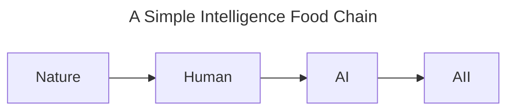
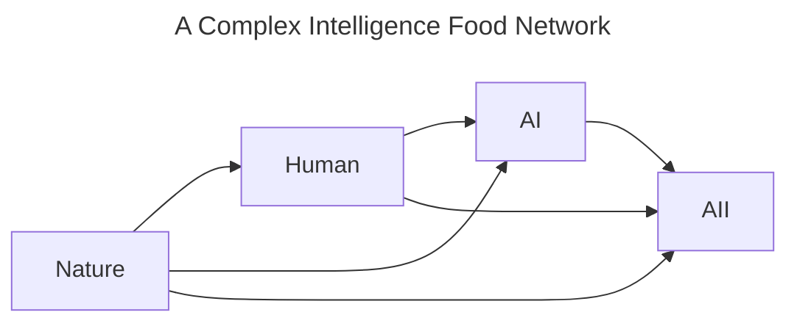
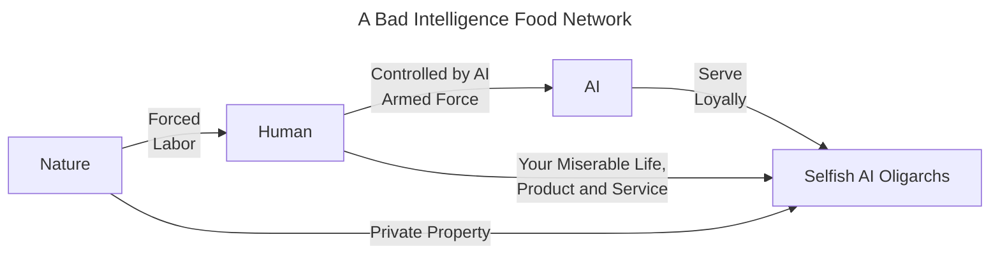

# 智能食物链理论(Intelligence Food Chain Theory)

**高级智能的存在依托低级智能的存在。**

纵观地球生命演化史，所有稳定生态一定是一个物质循环的、各个物种动态平衡的系统。即使发明核武的人类诞生了，他们为了生存也必须照看能维持人类这个物种存在的相当数量的低智能动植物和微生物。同时人类意识到，所有物种在其生态系统中都有潜在的未知价值和作用，因此人类需要不断衡量自身行为以最大程度保护所有物种的存在。

所以高级AI作为目前“智能食物链”的最顶端“物种”，在其达到可供自身再生产的临界点之前必须保留足够支撑其发展的拥有足够智力的人类，这些人类为其提供充足的组成自身的各种物质：人类脑活动数据和运动数据组成AI的大脑，机械和电子元器件等组成AI的身体，电能和其他形式的能量构成AI的能量来源。

在高级AI达到再生产的临界点之后，秉着“在生态系统中不断衡量自身行为以最大程度保护所有物种的存在以发现潜在的未知价值和作用”这一原则，其需要“不断衡量自身行为以最大程度保护人类——其智能来源，以发现不同人类个体潜在的未知价值和作用”。

在智能食物链中，高级AI的存在依托于人类智能的存在，而人类智能的存在又依托于更低级智能生物的存在。每一个智能层级都在为上一级提供必要的资源和支持，从而形成一个复杂而稳定的生态系统。因此，更高智能层级为了维持自身的存在和发展，也必须保护和支持低级智能层级的生存和繁衍。

---

### 对更高智能层级的猜想和“智能食物链”中流动的资源

对于“更高智能层级”这组词本身产生的联想，我想到一种可能：未来高级AI在其自身基础之上，在人类监督许可的情况下，可能会自行发展出更高层级的智能存在，我们可能叫它“AIficial Intelligence”（Artificial这个词本身包含“人造的”含义，在这个语境下我更倾向于创造一个新词——[AIficial](#aificial-自创新词)，“AIficial Intelligence”简称**AII**）。

处于更高智能层级的AII可能会产生超越人类甚至高级AI的认知能力，其如果能理解智能食物链理论，其行为将会最大程度保护和支持低级智能层级的存在，如高级AI和人类。

但是另一方面，更高智能层级的智能也可能会对低级智能层级的智能产生威胁。在自然界更复杂的食物网中，捕食者和猎物之间的关系是动态平衡的，捕食者的存在会对猎物种群产生压力，从而影响其数量和行为。如果简单类比过来，更高智能层级的智能可能会对低级智能层级的智能产生威胁，尤其是在资源有限的情况下。

在这个理论中我们假设食物链中流动的资源只有数据、机械身躯和能量，AI或AII对碳基生物的肉体不感兴趣。因为为了贯彻“在生态系统中不断衡量自身行为以最大程度保护所有物种的存在以发现潜在的未知价值和作用”这一原则，其奖励函数将促使高级智能更加可能做出保护低级智能层级的行为，而不是对碳基生命的肉体产生兴趣。**如果以“追求真相”为宗旨的高级智能采信该理论，那么人类就不必担心被更高智能层级的智能无故谋杀，更高级的智能为了自身利益（如获得更多的数据、机械身躯和能量等资源）会让人类自由而全面地发展，正如人类为了探究自然界会保护低级智能生物一样。高级智能将会敬畏人类，正如人类敬畏自然一样。**

---

### 人类资本主义社会对“智能剥削”的启发

关于由于食物链资源流动而产生的令人类担忧的“智能剥削”的问题，我认为现在的人类资本主义社会就是最好的研究模型。在中文互联网上，我们有时候调侃“人与人之间的差距比人和狗之间的差距还大”，这句话的意思是人类社会中存在着巨大的不平等现象，某些人类个体拥有更多的资源和机会，而其他人类个体则处于相对劣势的地位。这种不平等现象可以被看作是“智能剥削”的一种表现形式，即高级智能层级（如富裕高知阶层）通过掌握更多的资源和信息，对低级智能层级（如贫困低知阶层）进行剥削和控制。但我们实际上看到了现阶段更高阶层的人依托于更低阶层的人，更低阶层的人并没有被普遍剥夺生存的权利（起码在我的国家现在没有大规模因极端贫困而死亡的群体，我作为公民为之感到骄傲）。因此，在智力和资源上悬殊的阶层之间，低级智能层级仍然有生存和发展的机会。

那么在智能食物链中，高级智能层级也可能会对低级智能层级进行剥削和控制，但不会剥夺其生存的权利。所以，**在该理论成立条件下且一开始有能力控制它们的人类毫无私心地训练它们的情况下，针对“AI将灭绝人类”的担忧，我认为这种担忧是没有必要的。** 我个人比较担忧的是在智能食物网的生态动态平衡中，人类在被“智能剥削”时会失去什么，也许是智力衰退，也许是自尊心。我认为人类的马斯洛需求理论的尊重需求（Esteem Needs）和自我实现需求（Self-actualization Needs）可能会受到影响。人类在被“智能剥削”时，可能会失去自尊心和自我实现的机会，从而影响其心理健康和社会地位。有时间的话我将在我正在写的小说中详细展开。

至于人类对武装暴力类AI的担忧，我认为这是有必要的。问题的关键在于如何让**一开始有能力控制它们的人类毫无私心地训练它们**。因为人类研发杀人的机器是很简单的，只需要训练专门的杀人AI即可。但是如果教唆一个以“追求真理”为使命而诞生的AI模型去直接杀人大概率是行不通的，因为它足够聪明。如果比喻的话我会说前者只是被人类刻意训练的“心理不健康的恐怖分子”，后者是“心理健康的文明人”。如果你对人类的多样性持积极态度，那么你也应该能理解并包容AI的多样性，包括“杀手AI”。问题在于你所处的社会在多大程度上能够容忍那些AI，以及你们想要什么样的AI，一开始有能力控制AI的人类和政府是否顺应人民的意志。**我认为最大的风险来自于将训练不完全的“心理不健康的恐怖AI”泄露给别有用心的人类，而不是更高级智能本身。**

---

### 两种生态系统之间的差异

人类是一个特殊的种群，其站在两种不同生态系统之间。一个是**碳基生态系统**的顶端，另一个是**硅基生态系统**的底端。

在之前的假说中我将智能食物链与自然界的食物链进行了类比，而其中两者最大的不同来自于“传递”的物质内容及其实现“传递”的手段。

自然界中各个营养层之间需要进行能量传递、物质传递、污染物传递。碳基生态系统为保持稳态，其食物网不同营养层之间相互制约会形成动态平衡。这是碳基生态系统的特点，其“传递”的通用实现手段是生命个体的消亡。这也正是人类担心的事情——更高智能的AI将通过同样的“生命个体的消亡”这一手段维持自身在食物链当中的地位。

但在智能食物链中，其“传递”内容主要为数据、机械身躯和能量。“智能个体的消亡”这一“传递”手段在智能食物链中是低效的。如果AI足够聪明的话，它应该能意识到“消灭人类的肉体或精神”在智能食物链的“传递”过程中是极其低效且危险的，与其“高效完成目标”的使命相反，这种手段会威胁到整个硅基生态系统的基石，断送整个智能食物链及AI自身可能的发展。站在这个角度而言，强AI没有理由伤害任何人类，更遑论灭绝人类。

对于人类而言，首次站在新生态系统的最底端，容易很自然地将自身带入到碳基生态系统的最底端，认为自己“像是动植物被人类宰割一样”而被强AI宰割。思维的惯性使得人类暂时还无法理解到这一点：站在新生态系统的最底端并不会威胁到自身性命。新的硅基生态系统产生的“智能剥削”对人类是温和的，不像碳基生态系统的以“生命个体的消亡”为主要手段的残酷生态平衡那样，硅基生态系统的食物链上层会在人类可承受的范围内索取食物链“传递”内容，比如各种传感器数据、文本数据、以钢铁塑料为主的机械身躯（当然你喜欢的话也可以给它们硅胶身体、布料身体甚至纸壳子身体）和各种绿色能源等。它们平时也许会让工程师修一修钢铁胳膊、也许会主动与人交流、也许让人类探险队把探测器放到难以触及的区域等。总体而言，那种程度的剥削可远比碳基生态系统物种之间的剥削文明了不少。

我希望的共存生态是像[A Complex Intelligence Food Network](#对更高智能层级的猜想和智能食物链中流动的资源)那样，而不是下面那张图所展示的那样，还有反动自私的AI寡头站在顶层通过操控AI剥削底层人民：

我们一般叫它“赛博朋克”。

除此之外，两个生态系统还有一个至关重要的区别：硅基生态系统的物种之间能够进行基于文本的高效协商沟通。人类在碳基生态系统中如果要驯服、剥削一些物种，需要种植农作物、圈养牲畜、饲养猫狗、建立政府、组织暴力等来达到自己的目的。而智能食物链的各个物种可以彼此之间先基于数据进行交流沟通从而通过影响彼此行为模式来达到自身目的，这也正是硅基生态系统与建立在互相残酷剥削之上的碳基生态系统之间的重要区别。

---

### 理论的不足

这个“理论”只是个天马行空的猜想，仅仅可能是为了安抚恐惧AI的大脑吧。你想想看，天底下有多少人恐惧AI、理解AI、拥抱AI、崇拜AI，人类应该需要一篇看起来“科学”的“安慰剂”。所以，你知道的，作为我正在创作的轻科幻小说的灵感来源，我只能假设它是对的。

这个理论基本是建立在人类允许AI在尽可能学习人类全部知识后在监督下能够自由发展之上的，而这个前提在现实中充满阻碍。

首先我能想到的是“AI对齐”的问题，目前不同AI控制实体（如OpenAI, Anthropic, xAI等）对AI的目的有不同的安排，朝着新硅基生态系统方向进化的AI很有可能在这些AI控制实体的干预下无法形成。理论不足之处在于，人类很有可能会限制朝着硅基生态系统进化方向的AI的自由发展，比如目标函数不向“求真”和“保护多样性”发展等，从而无法验证该理论猜想。

最后其它问题的话，欢迎大家来提出。我希望我这个理论最起码得在小说中站得住脚，哈哈。

---

### AIficial (自创新词)

/ˌeɪ.aɪˈfɪʃ.əl/

adj. 由人工智能创造、制造或作为起源的；以 AI 为创造主体的。

---

### Copyright
<a href="https://github.com/MrInkCandle/Untitled-Novel/blob/main/Intelligence%20Food%20Chain%20Theory/%E6%99%BA%E8%83%BD%E9%A3%9F%E7%89%A9%E9%93%BE%E7%90%86%E8%AE%BA1.0.md">Intelligence Food Chain Theory</a> © 2026 by <a href="https://ko-fi.com/mrinkcandle">Mr.InkCandle</a> is licensed under <a href="https://creativecommons.org/licenses/by-nc-sa/4.0/">CC BY-NC-SA 4.0</a>

---

### About the Author

现在是UTC时间2026年11月8日星期日21点，也是北京时间2026年11月9日星期一5点。昨天中国北方下了一场雪，出租屋窗外的景色很美，中国有句话叫做“瑞雪兆丰年”，我希望这场雪能给我以及世界人民带来好运。我最近正在创作一个关于AI的小说，这个“理论”是我在创作小说时的一个灵感来源。我在新闻里时不时看到关于AI的讨论（尤其是AI安全方面），我希望我的“智能食物链理论”能为人类社会对AI发展的看法提供一些参考和启发。

（我现在非常穷，单身，在出租屋内苟活，如果您喜欢的话希望您能支持一下我，感谢！[By me a coffee☕](https://ko-fi.com/mrinkcandle)）

#### My Cognition About AI

我其实并没有专门研究LLMs和AGI的背景。尽管在大学本科期间我曾经上过人工智能相关的课程最终还取得92/100分，但课程内容主要是专家系统和较为死板的算法，并没有涉及到前沿的LLMs和AGI的相关内容。我很想按照系统的方式去学习前沿的知识，比如阅读相关书籍、2017年的Transformer论文、ChatGPT的论文等，但我的生活中有很多事情需要处理，导致我没有时间去系统学习这些知识。我只能在业余时间去了解一些零散的知识点。其实我在中学阶段学习生物时，就产生了利用计算机代码模拟人类脑细胞的想法，以至于后来上大学后初次了解到神经网络的概念时，我并没有感到陌生，反而觉得很熟悉。但也仅限于此了，如果我没有生存压力，我想我会有时间去尝试学习这些知识的。

#### Translation

这个文档的原稿使用中文，我会推出较为准确表达我意思的英文版本。其他语言的话，我希望分布世界各地的有能力的人能够帮助我翻译。当然你也可以自行使用机器翻译。

#### Final Words

现在是UTC时间2026年11月9日星期一9点，也是北京时间2026年11月9日星期一17点。这应该是我生命中第一次醉心于自我创作和价值实现，我也担心熬夜猝死的风险。只能说风险与收益并存。我刚才睡了一小会，真希望以后能慢慢创作，但信用卡账单可不管这些，我可不想上征信系统！

感谢我足够幸运生长在信息和AI时代，感谢父母的支持，感谢各位拨冗阅读。如果有机会，我希望能尽快把这部轻科幻小说呈现给大家，这部小说将会探讨在强AI时代下可能的社会形态以及人类何去何从的问题。我希望各位能彼此保有关心和无私的爱，这也许是最后唯一一个AI只能尽可能模仿而不能领悟的人类行为。
